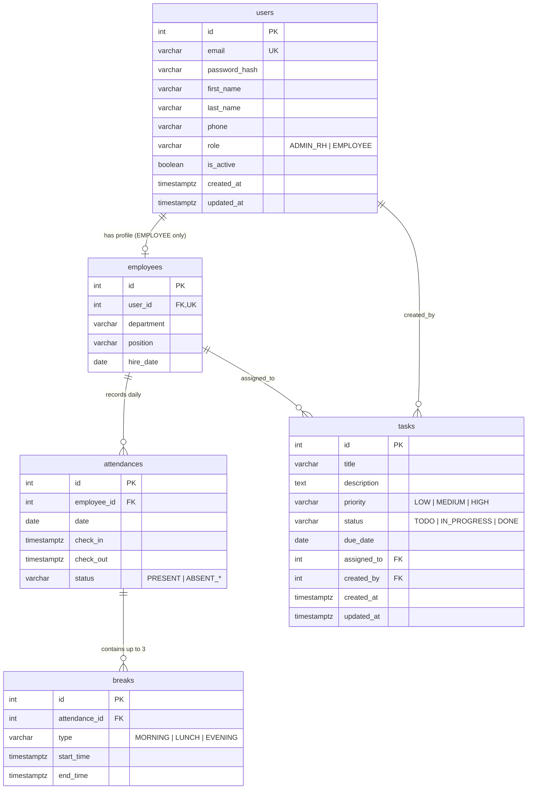
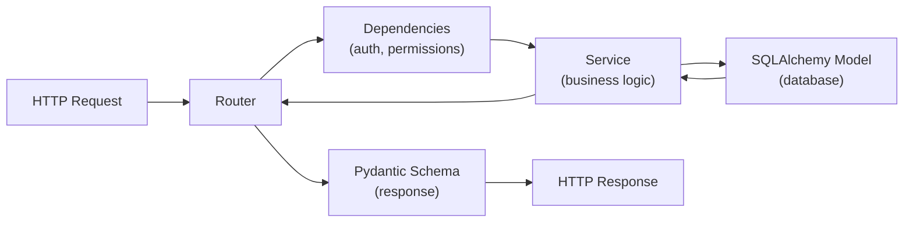
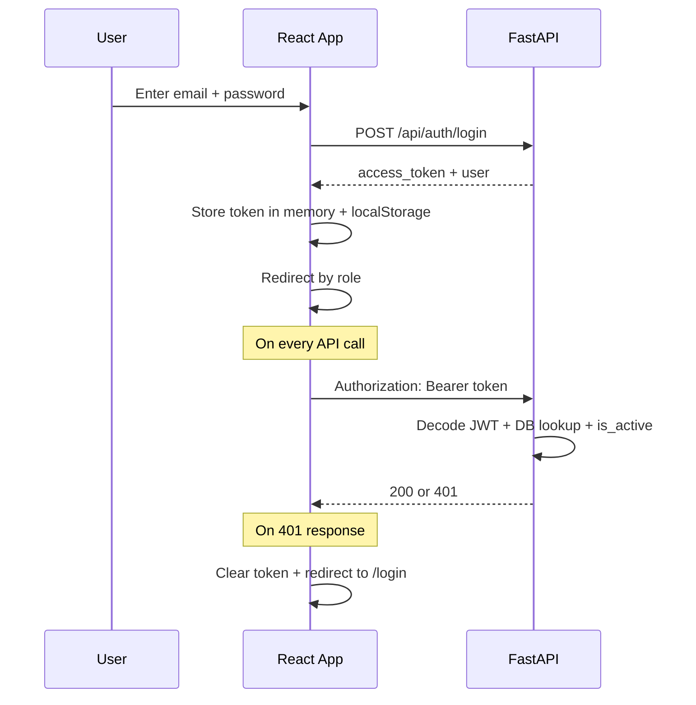
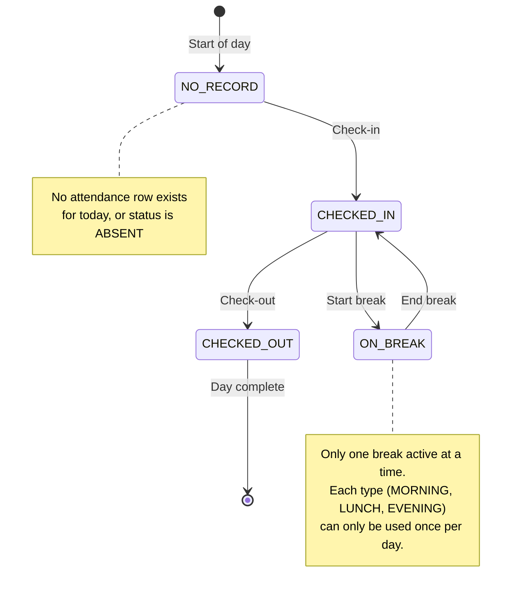
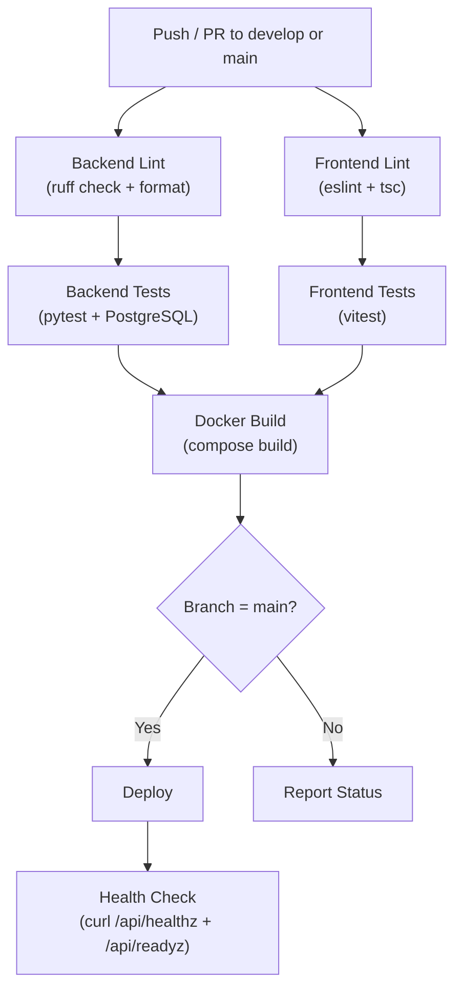

# LOGICAT RH — PROJECT PLAN

> Final Implementation Blueprint · v1.1 · 2026-11-06

**This document is the single authoritative implementation reference for the LOGICAT RH project. All development decisions, AI coding sessions, and code reviews must conform to this plan and the official Cahier des Charges.**

---

## 1. Requirements Summary

### 1.1 Project Identity

| Field | Value |
|-------|-------|
| **Project** | Application RH — Pointage & Gestion des Tâches |
| **Client** | LOGICAT GROUP, Maroc |
| **Format** | Individual technical assessment |
| **Deadline** | 5 days (strict) |
| **Deliverable** | GitHub repository with full-stack application |

### 1.2 What the Application Must Do

An HR web application with **two separate portals**:

- **Admin RH** — Manages all users, monitors attendance across the organization, declares absences, and creates/assigns/tracks professional tasks.
- **Employee** — Views personal profile, records daily attendance (check-in, three breaks, check-out), views assigned tasks and updates their status.

### 1.3 What Is Being Evaluated

The cahier des charges explicitly states the evaluation criteria:

1. **Functional design and data modeling** — correct relational schema, constraints, relationships.
2. **API development and React/FastAPI integration** — RESTful endpoints, proper HTTP semantics.
3. **Access control and business rule enforcement** — RBAC, resource ownership, attendance rules.
4. **Code quality, tests, documentation, and presentation** — clean code, meaningful tests, Swagger, README.

### 1.4 Non-Negotiable Requirements (From Cahier)

- No public registration. Admin RH creates all accounts.
- Passwords are hashed. Never stored in plaintext.
- A deactivated account must be rejected on every API request, even with a valid JWT.
- An admin cannot deactivate their own account or the last active Admin RH.
- All permission checks are enforced on the backend. Changing an ID in a request must never expose another employee's data.
- Attendance timestamps are generated by the server, not submitted by the client.
- The attendance state machine must be strictly enforced (see §10).
- Three demo accounts: 2 Admin RH + 1 Employee, with fictitious data.
- Demo data must be fictitious. No real personal information.

---

## 2. Confirmed Technology Stack

**These decisions are final. Do not propose alternatives.**

### 2.1 Tool Strategy

| Tool | Role | Notes |
|------|------|-------|
| **OpenCode** | Primary: backend implementation, plan updates, tests, documentation, frontend code generation | Runs on native Windows (no WSL2 required). |
| **Antigravity** | Optional: UI polish, visual QA when quota permits | Fallback if unavailable: manual browser verification on Day 3–4. |
| **Manual browser** | Required: Day 3–4 verification gate | Every admin and employee flow must be clicked through in a real browser before sign-off. |

The Day 3 and Day 4 exit criteria are verified by manual browser walkthroughs, not by automated UI testing. CI and deployment are out of scope for the 5-day window (§13, §14).

### Backend
| Component | Technology |
|-----------|-----------|
| Language | Python 3.12+ |
| Framework | FastAPI |
| ORM | SQLAlchemy 2.0 (sync sessions) |
| Validation | Pydantic v2 |
| Migrations | Alembic |
| JWT | PyJWT |
| Password hashing | argon2-cffi (Argon2id) |

### Frontend
| Component | Technology |
|-----------|-----------|
| Language | TypeScript |
| Framework | React 18+ |
| Build tool | Vite |
| Routing | React Router v6 |
| Styling | Tailwind CSS |
| Components | shadcn/ui |
| HTTP client | Axios |
| Server state | TanStack Query v5 |
| Forms | React Hook Form + Zod |

### Infrastructure
| Component | Technology |
|-----------|-----------|
| Database | PostgreSQL 16 |
| Containers | Docker Compose |
| Version control | Git + GitHub |
| CI/CD | GitHub Actions |
| Backend testing | Pytest + HTTPX |
| Frontend testing | Vitest + React Testing Library |

### Design
| Aspect | Decision |
|--------|----------|
| Visual identity | LOGICAT blue (`#1E40AF` primary, `#3B82F6` accent) |
| Admin portal | Desktop-first layout |
| Employee portal | Mobile-first layout |
| Typography | Inter (UI) + JetBrains Mono (timestamps/durations) |
| Theme | Light only. No dark mode. |

---

## 3. Functional Modules

### Module 1: Authentication & Account Lifecycle

- Login with email + password → JWT access token.
- Role-based redirection after login (Admin → admin dashboard, Employee → employee dashboard).
- Every protected endpoint verifies the JWT **and** checks `is_active` in the database.
- No public registration. No password recovery flow (admin resets passwords).
- Seeded initial Admin RH account bootstraps the system.
- Logout clears the token client-side.

### Module 2: User Management (Admin RH Only)

- Create users with role `ADMIN_RH` or `EMPLOYEE`.
- List, search, and filter users by name, role, status, department.
- View user detail (including employee professional information).
- Edit user information.
- Deactivate/Reactivate users (with self-deactivation and last-admin protections).
- Reset user password (admin sets a new password).

### Module 3: Employee Profile (Employee Only)

- View own profile (all fields, read-only for most).
- Edit only: phone number and password.
- Cannot change: role, department, position, status, name, email.

### Module 4: Attendance & Breaks

- **Employee actions**: Check-in, start/end three break types (morning, lunch, evening), check-out.
- **Admin actions**: View all employees' attendance, filter by date and employee, declare justified/unjustified absences.
- **Calculations**: Presence time, total break time, effective working time.
- **Rules**: Strict state machine (see §10).

### Module 5: Task Management

- **Admin**: Create tasks with title, description, priority, deadline, and assigned employee. Full CRUD. Filter by employee, priority, status.
- **Employee**: View only assigned tasks. Update only the status field (`TODO` → `IN_PROGRESS` → `DONE`). Cannot create, reassign, edit content, or delete.

### Module 6: Dashboards

- **Admin Dashboard**: Active employees count, present today count, absence count, total tasks, in-progress tasks, completed tasks.
- **Employee Dashboard**: Personal info (name, department, position), today's attendance status and times, effective working time, task counters (To Do / In Progress / Done).

---

## 4. Permission Matrix

**Source of truth**: Cahier des Charges, page 4.

| Functionality | Admin RH | Employee |
|---------------|----------|----------|
| Login / Logout | ✅ | ✅ |
| Create Admin RH or Employee | ✅ | ❌ |
| Modify / Deactivate accounts | ✅ | ❌ |
| View all users | ✅ | ❌ |
| View and update own profile | ✅ | ✅ (phone + password only) |
| View all attendance / breaks | ✅ | ❌ |
| Perform check-in, breaks, check-out | ❌ | ✅ (personal only) |
| View own attendance | Per profile | ✅ |
| View working hours | All employees | Own hours only |
| Declare absence | ✅ | ❌ |
| Create / assign / modify / delete tasks | ✅ | ❌ |
| View all tasks | ✅ | ❌ |
| View own assigned tasks | — | ✅ |
| Change status of own tasks | — | ✅ |

**CRITICAL: Every permission check must be enforced on the backend.** Frontend visibility is a convenience, not a security measure. All IDOR vectors must be eliminated by scoping queries to `current_user.id`.

---

## 5. Database Schema

### 5.1 DDL (PostgreSQL)

```sql
-- ============================================================
-- USERS: Authentication, identity, and account status
-- ============================================================
CREATE TABLE users (
    id            SERIAL PRIMARY KEY,
    email         VARCHAR(255) UNIQUE NOT NULL,
    password_hash VARCHAR(255) NOT NULL,
    first_name    VARCHAR(100) NOT NULL,
    last_name     VARCHAR(100) NOT NULL,
    phone         VARCHAR(30),
    role          VARCHAR(20) NOT NULL CHECK (role IN ('ADMIN_RH', 'EMPLOYEE')),
    is_active     BOOLEAN NOT NULL DEFAULT TRUE,
    created_at    TIMESTAMPTZ NOT NULL DEFAULT now(),
    updated_at    TIMESTAMPTZ NOT NULL DEFAULT now()
);

-- ============================================================
-- EMPLOYEES: Professional info (1:1 with users, EMPLOYEE only)
-- ============================================================
CREATE TABLE employees (
    id          SERIAL PRIMARY KEY,
    user_id     INTEGER UNIQUE NOT NULL REFERENCES users(id) ON DELETE CASCADE,
    department  VARCHAR(100),
    position    VARCHAR(100),
    hire_date   DATE
);

-- ============================================================
-- ATTENDANCES: Daily attendance record per employee
-- ============================================================
CREATE TABLE attendances (
    id          SERIAL PRIMARY KEY,
    employee_id INTEGER NOT NULL REFERENCES employees(id) ON DELETE CASCADE,
    date        DATE NOT NULL,
    check_in    TIMESTAMPTZ,
    check_out   TIMESTAMPTZ,
    status      VARCHAR(30) NOT NULL DEFAULT 'PRESENT'
                CHECK (status IN ('PRESENT', 'ABSENT_JUSTIFIED', 'ABSENT_UNJUSTIFIED')),
    UNIQUE (employee_id, date)
);

-- ============================================================
-- BREAKS: Break records within an attendance day
-- ============================================================
CREATE TABLE breaks (
    id            SERIAL PRIMARY KEY,
    attendance_id INTEGER NOT NULL REFERENCES attendances(id) ON DELETE CASCADE,
    type          VARCHAR(20) NOT NULL CHECK (type IN ('MORNING', 'LUNCH', 'EVENING')),
    start_time    TIMESTAMPTZ NOT NULL,
    end_time      TIMESTAMPTZ,
    UNIQUE (attendance_id, type)
);

CREATE UNIQUE INDEX breaks_one_active_per_attendance
  ON breaks (attendance_id)
  WHERE end_time IS NULL;

-- ============================================================
-- TASKS: Professional tasks assigned to employees
-- ============================================================
CREATE TABLE tasks (
    id          SERIAL PRIMARY KEY,
    title       VARCHAR(200) NOT NULL,
    description TEXT,
    priority    VARCHAR(20) NOT NULL DEFAULT 'MEDIUM'
                CHECK (priority IN ('LOW', 'MEDIUM', 'HIGH')),
    status      VARCHAR(20) NOT NULL DEFAULT 'TODO'
                CHECK (status IN ('TODO', 'IN_PROGRESS', 'DONE')),
    due_date    DATE,
    assigned_to INTEGER NOT NULL REFERENCES employees(id) ON DELETE CASCADE,
    created_by  INTEGER NOT NULL REFERENCES users(id),
    created_at  TIMESTAMPTZ NOT NULL DEFAULT now(),
    updated_at  TIMESTAMPTZ NOT NULL DEFAULT now()
);
```

### 5.2 Entity-Relationship Diagram



### 5.3 Key Design Decisions

| Decision | Rationale |
|----------|-----------|
| `attendances.employee_id` → `employees.id` (not `users.id`) | Consistent FK chain: `users` → `employees` → `attendances` → `breaks`. Tasks follow the same pattern for `assigned_to`. |
| `tasks.assigned_to` → `employees.id` | Tasks are assigned to employees, not generic users. Admin RH does not receive tasks. |
| `tasks.created_by` → `users.id` | Task creators are Admin RH users, not employees. |
| `UNIQUE(employee_id, date)` on attendances | Enforces one attendance record per employee per calendar day at the database level. |
| `UNIQUE(attendance_id, type)` on breaks | Enforces each break type can only occur once per day at the database level. |
| Absence = attendance row with `ABSENT_*` status | No check-in/check-out times. If an employee already checked in for that day, reject the admin's absence declaration. |
| All timestamps stored in UTC | "Today" is computed using `Africa/Casablanca` timezone. Convention documented in README. |
| `employees` table only for `EMPLOYEE` role | Admin RH accounts do not need department/position. Creating a user with role `EMPLOYEE` also creates the `employees` row. |
| Partial unique index on `breaks (attendance_id) WHERE end_time IS NULL` | Guarantees at most one active break per attendance at the database level. Service-level validation and transaction locking are retained as defense-in-depth. A PostgreSQL `IntegrityError` from this constraint is caught by the service layer and mapped to HTTP 409 "a break is already active". |

### 5.4 Concurrency & Transaction Requirements

| Operation | Protection Required |
|-----------|-------------------|
| Admin deactivation | In one transaction: `SELECT id FROM users WHERE role = 'ADMIN_RH' AND is_active = TRUE ORDER BY id FOR UPDATE` (deterministic ordering to avoid deadlocks), count active admins after locking, block if count ≤ 1 or if the target is the requesting admin (self-deactivation). Self-deactivation restriction preserved. |
| Check-in | Atomic `INSERT ... ON CONFLICT (employee_id, date) DO NOTHING RETURNING id`. If no row is returned (conflict), return HTTP 409 "already checked in today". The `UNIQUE(employee_id, date)` constraint guarantees one attendance record per employee per business date at the database level — `SELECT ... FOR UPDATE` is not used because it cannot lock a row that does not yet exist. |
| Break start | Transaction: verify no active break (via `SELECT ... FOR UPDATE` on existing break rows or the partial unique index), verify break type not already used today, verify checked in, then insert. |
| Break end | Transaction: verify break belongs to current user, verify break is active (no `end_time`), then update. |
| User creation with EMPLOYEE role | Transaction: insert `users` row + insert `employees` row atomically. |

---

## 6. Backend Architecture

### 6.1 Project Structure

```
backend/
├── app/
│   ├── __init__.py
│   ├── main.py                    # FastAPI app, CORS, lifespan, router includes
│   ├── core/
│   │   ├── config.py              # Pydantic Settings (env vars)
│   │   ├── security.py            # JWT encode/decode, Argon2id hash/verify
│   │   ├── dependencies.py        # get_db, get_current_user, get_current_active_user
│   │   └── permissions.py         # require_admin, require_employee, require_owner
│   ├── models/
│   │   ├── __init__.py            # Base, imports
│   │   ├── user.py
│   │   ├── employee.py
│   │   ├── attendance.py
│   │   ├── break_.py              # underscore to avoid Python keyword
│   │   └── task.py
│   ├── schemas/
│   │   ├── auth.py                # LoginRequest, TokenResponse
│   │   ├── user.py                # UserCreate, UserUpdate, UserResponse, UserList
│   │   ├── employee.py            # EmployeeProfileUpdate (phone + password only)
│   │   ├── attendance.py          # AttendanceResponse, AttendanceSummary, AbsenceCreate
│   │   ├── break_.py              # BreakStartRequest, BreakResponse
│   │   ├── task.py                # TaskCreate, TaskUpdate, TaskStatusUpdate, TaskResponse
│   │   └── dashboard.py           # AdminDashboard, EmployeeDashboard
│   ├── routers/
│   │   ├── auth.py
│   │   ├── users.py
│   │   ├── employees.py
│   │   ├── attendances.py
│   │   ├── breaks.py
│   │   ├── tasks.py
│   │   └── dashboard.py
│   ├── services/
│   │   ├── auth_service.py
│   │   ├── user_service.py
│   │   ├── attendance_service.py  # State machine logic lives here
│   │   ├── break_service.py
│   │   ├── task_service.py
│   │   └── dashboard_service.py
│   └── database/
│       ├── session.py             # Engine, SessionLocal, get_db
│       └── base.py                # Declarative base
├── alembic/
│   ├── alembic.ini
│   ├── env.py
│   └── versions/
├── tests/
│   ├── conftest.py                # Fixtures: test DB, test client, auth helpers
│   ├── test_auth.py
│   ├── test_users.py
│   ├── test_attendances.py
│   ├── test_breaks.py
│   ├── test_tasks.py
│   ├── test_permissions.py        # IDOR, role checks, edge cases
│   └── test_calculations.py       # Working time arithmetic
├── seed.py                        # Creates 3 demo accounts + sample data
├── pyproject.toml                 # Dependencies, tool config
├── Dockerfile
└── .env.example
```

### 6.2 Architecture Principle

**Routers** handle HTTP. **Services** handle business logic. **Models** handle persistence. **Schemas** handle validation.



### 6.3 Dependency Injection Chain

```python
# Two-tier dependency chain. get_current_employee depends on get_current_user.
# Both arg orders are valid Python (all params use Depends(...) defaults).

get_db()                                  # → yields SQLAlchemy session
get_current_user(db)                       # → decodes JWT, loads User from DB, checks is_active
get_current_employee(user, db)             # → loads Employee profile; raises 403 if role != EMPLOYEE
require_admin(user)                        # → raises 403 if role != ADMIN_RH
require_employee(user)                     # → alias guard; 403 if role != EMPLOYEE
```

Every employee-scoped endpoint MUST depend on `get_current_employee`. It derives the employee from the authenticated User — the request body and URL must never supply an `employee_id`.

**WARNING: `get_current_user` must ALWAYS query the database and verify `is_active`. Never rely solely on JWT claims. This is the #1 security trap identified by all reviewers.**

### 6.4 Mass-Assignment Prevention

Use **separate Pydantic schemas per role and per action**:

| Schema | Allowed Fields | Who Can Use |
|--------|---------------|-------------|
| `UserCreate` | All user + employee fields | Admin only |
| `UserUpdate` | Identity + professional fields | Admin only |
| `EmployeeProfileUpdate` | `phone`, `password` only | Employee (self, via get_current_employee) |
| `TaskCreate` | title, description, priority, due_date, assigned_to | Admin only |
| `TaskUpdate` | title, description, priority, due_date, assigned_to | Admin only |
| `TaskStatusUpdate` | `status` only | Employee (own tasks) |

Employee profile updates derive identity from `get_current_employee`. The request body must not include role, department, position, hire_date, is_active, or email — those are admin-only fields handled by `UserUpdate`.

---

## 7. Frontend Architecture

### 7.1 Project Structure

```
frontend/
├── src/
│   ├── main.tsx
│   ├── App.tsx                    # Router setup
│   ├── api/
│   │   ├── client.ts              # Axios instance + 401 interceptor
│   │   ├── auth.ts                # login(), logout(), getMe()
│   │   ├── users.ts               # Admin user management API calls
│   │   ├── attendances.ts         # Attendance + breaks API calls
│   │   ├── tasks.ts               # Task API calls
│   │   └── dashboard.ts           # Dashboard API calls
│   ├── auth/
│   │   ├── AuthContext.tsx         # Auth state (user, token, login, logout)
│   │   ├── ProtectedRoute.tsx     # Requires authentication
│   │   └── RoleGuard.tsx          # Requires specific role
│   ├── components/
│   │   ├── ui/                    # shadcn/ui components (Button, Input, Card, etc.)
│   │   ├── layout/
│   │   │   ├── AdminLayout.tsx    # Sidebar + topbar (desktop-first)
│   │   │   └── EmployeeLayout.tsx # Bottom nav or compact header (mobile-first)
│   │   └── shared/
│   │       ├── DataTable.tsx
│   │       ├── StatusBadge.tsx
│   │       ├── LoadingSkeleton.tsx
│   │       └── EmptyState.tsx
│   ├── pages/
│   │   ├── auth/
│   │   │   └── LoginPage.tsx
│   │   ├── admin/
│   │   │   ├── DashboardPage.tsx
│   │   │   ├── UsersPage.tsx
│   │   │   ├── UserDetailPage.tsx
│   │   │   ├── AttendancePage.tsx
│   │   │   └── TasksPage.tsx
│   │   └── employee/
│   │       ├── DashboardPage.tsx
│   │       ├── ProfilePage.tsx
│   │       ├── AttendancePage.tsx  # Check-in/out + breaks widget
│   │       └── TasksPage.tsx
│   ├── hooks/
│   │   ├── useAuth.ts
│   │   ├── useAttendance.ts
│   │   └── useTasks.ts
│   ├── schemas/                   # Zod validation schemas (mirror backend)
│   ├── types/                     # TypeScript interfaces
│   └── lib/
│       ├── utils.ts               # cn() helper, date formatting
│       └── constants.ts           # Roles, statuses, priorities
├── index.html
├── tailwind.config.ts
├── tsconfig.json
├── vite.config.ts
├── Dockerfile
└── package.json
```

### 7.2 Routing Structure

```
/login                          → LoginPage (public)

/admin                          → AdminLayout (requires ADMIN_RH)
  /admin/dashboard              → Admin DashboardPage
  /admin/users                  → UsersPage (list + create)
  /admin/users/:id              → UserDetailPage (edit + deactivate)
  /admin/attendance             → AttendancePage (all employees)
  /admin/tasks                  → TasksPage (CRUD + assign)

/employee                       → EmployeeLayout (requires EMPLOYEE)
  /employee/dashboard           → Employee DashboardPage
  /employee/profile             → ProfilePage (phone + password)
  /employee/attendance          → AttendancePage (personal check-in/out widget)
  /employee/tasks               → TasksPage (view + status update)
```

### 7.3 Authentication Flow (Frontend)



### 7.4 Token Storage Strategy

| Aspect | Decision |
|--------|----------|
| **Storage location** | `localStorage` for persistence across page reloads. Token also held in React state (AuthContext) for immediate access. |
| **Token type** | Short-lived access token only (30 min expiry). No refresh token — keep it simple for a 5-day project. |
| **Logout behavior** | Remove token from `localStorage` and AuthContext. Client-side only — no server-side token blacklist. |
| **401 handling** | Axios response interceptor catches 401 → clears stored token → redirects to `/login`. |
| **Security note** | The backend verifies `is_active` in the database on every request, so a stolen or stale token for a deactivated user is effectively useless. |

---

## 8. API Endpoint Inventory

### 8.1 Authentication (3 endpoints)

| Method | Endpoint | Auth | Description |
|--------|----------|------|-------------|
| `POST` | `/api/auth/login` | Public | Email + password → access token + user info |
| `GET` | `/api/auth/me` | Any authenticated (ADMIN_RH or EMPLOYEE) | Returns current user with role and employee info |
| `POST` | `/api/auth/logout` | Any authenticated | No-op server side; client clears token |

### 8.1.5 Health (1 endpoint, public — no authentication)

| Method | Endpoint | Auth | Description |
|--------|----------|------|-------------|
| `GET` | `/api/healthz` | Public | Application liveness check. Returns `{"status": "ok"}`. |
| `GET` | `/api/readyz` | Public | Database readiness check. Verifies DB connectivity. Returns `{"status": "ready"}` or 503 if DB unreachable. |

### 8.2 User Management — Admin RH Only (7 endpoints)

| Method | Endpoint | Description |
|--------|----------|-------------|
| `POST` | `/api/users` | Create user (ADMIN_RH or EMPLOYEE). If EMPLOYEE, also creates employees row. |
| `GET` | `/api/users` | List users with search (`?q=`) and filters (`?role=`, `?is_active=`, `?department=`) |
| `GET` | `/api/users/{id}` | User detail + employee professional info |
| `PUT` | `/api/users/{id}` | Update user info (identity + professional fields) |
| `PATCH` | `/api/users/{id}/deactivate` | Deactivate. Blocked if self or last active admin. |
| `PATCH` | `/api/users/{id}/activate` | Reactivate a deactivated user. |
| `PATCH` | `/api/users/{id}/reset-password` | Admin sets a new password for the user. |

### 8.3 Employee Profile — Employee Only (1 endpoint)

| Method | Endpoint | Auth | Description |
|--------|----------|------|-------------|
| `PATCH` | `/api/employees/me/profile` | Employee | Update phone and/or password only. Identity derived from token — never from a user-supplied ID. Role, department, position, status, name, and email are not modifiable through this endpoint. |

Self-profile read is served by GET /api/auth/me (§8.1) for both roles.

**Assumption (Admin RH self-profile):** The official cahier does not explicitly specify which fields an Admin RH may edit on their own profile. It is assumed that Admin RH can edit their own `phone` and `password`, but cannot change their own `role` or `is_active` status. Admin RH account lifecycle (deactivation, role changes) remains an admin-only operation on `/api/users/{id}`.

### 8.4 Attendance — Mixed Roles (6 endpoints)

| Method | Endpoint | Auth | Description |
|--------|----------|------|-------------|
| `POST` | `/api/attendances/check-in` | Employee | Server-generated timestamp. Creates attendance row. |
| `POST` | `/api/attendances/check-out` | Employee | Server-generated timestamp. Blocked if break active. |
| `GET` | `/api/attendances/today` | Employee | Today's attendance + breaks + computed times. |
| `GET` | `/api/attendances/me` | Employee | Personal attendance history with filters (`?date_from=`, `?date_to=`). |
| `GET` | `/api/attendances` | Admin | All employees' attendance. Filters: `?employee_id=`, `?date_from=`, `?date_to=`. |
| `POST` | `/api/attendances/absences` | Admin | Declare justified or unjustified absence for an employee on a date. |

### 8.5 Breaks — Employee Only (2 endpoints)

| Method | Endpoint | Auth | Description |
|--------|----------|------|-------------|
| `POST` | `/api/breaks/start` | Employee | Start a break. Body: `{ "type": "MORNING" | "LUNCH" | "EVENING" }`. Server timestamp. |
| `POST` | `/api/breaks/{break_id}/end` | Employee | End a break. Ownership verified. Server timestamp. |

### 8.6 Tasks — Mixed Roles (7 endpoints)

| Method | Endpoint | Auth | Description |
|--------|----------|------|-------------|
| `POST` | `/api/tasks` | Admin | Create + assign to an employee. |
| `GET` | `/api/tasks` | Admin | All tasks. Filters: `?assigned_to=`, `?priority=`, `?status=`. |
| `GET` | `/api/tasks/me` | Employee | Own assigned tasks only. Filters: `?priority=`, `?status=`. |
| `GET` | `/api/tasks/{id}` | Admin or Owner | Task detail. Employee can only see own tasks. |
| `PUT` | `/api/tasks/{id}` | Admin | Full update (title, description, priority, due_date, assigned_to). |
| `DELETE` | `/api/tasks/{id}` | Admin | Delete task. |
| `PATCH` | `/api/tasks/{id}/status` | Employee | Update status only (`TODO` / `IN_PROGRESS` / `DONE`). Ownership verified. |

### 8.7 Dashboards (2 endpoints)

| Method | Endpoint | Auth | Description |
|--------|----------|------|-------------|
| `GET` | `/api/dashboard/admin` | Admin | KPIs: active employees, present today, absences, task counts. |
| `GET` | `/api/dashboard/employee` | Employee | Personal: today's status, working time, task counters. |

**28 business endpoints + 2 health endpoints = 30 unique endpoints. GET /api/auth/me appears exactly once (§8.1) and serves both roles.**

### 8.8 Optional Endpoint

| Method | Endpoint | Auth | Description |
|--------|----------|------|-------------|
| `GET` | `/api/attendances/export` | Admin | CSV export of attendance data. **Optional — implement only if time permits on Day 5.** |

---

## 9. Authentication & Authorization Strategy

### 9.1 Authentication Flow

1. **Login**: `POST /api/auth/login` with `{ email, password }`.
2. **Verify**: Load user by email. Verify Argon2id hash. Check `is_active`.
3. **Issue**: Return JWT access token with payload: `{ sub: user_id, role: role, exp: now + 30min }`.
4. **Use**: Frontend sends `Authorization: Bearer <token>` on every request.
5. **Validate**: `get_current_user` dependency decodes JWT, loads user from DB, verifies `is_active`. Returns 401 if any check fails.

### 9.2 JWT Configuration

| Parameter | Value |
|-----------|-------|
| Algorithm | HS256 |
| Secret | `SECRET_KEY` env var (min 32 chars, cryptographically random) |
| Expiry | 30 minutes |
| Payload | `{ sub: <user_id>, role: <role>, exp: <timestamp> }` |

### 9.3 Authorization Dependencies

| Dependency | Behavior |
|------------|----------|
| `get_current_user(db)` | Decodes JWT + DB lookup + is_active check → User object |
| `get_current_active_user` | Alias (same as above, explicit naming) |
| `get_current_employee(user, db)` | Loads Employee profile for the current User. Raises 403 if role != EMPLOYEE. Identity derived from token only. |
| `require_admin(user)` | Raises HTTPException(403) if user.role != ADMIN_RH |
| `require_employee(user)` | Raises HTTPException(403) if user.role != EMPLOYEE |

### 9.4 IDOR Prevention Rules

For every employee-facing endpoint:
- **Never accept `employee_id` or `user_id` from the request path or body** for ownership-scoped operations.
- **Always derive identity from the JWT token** via `get_current_user`.
- Query attendance, breaks, and tasks using the current user's employee record, not a user-supplied ID.

### 9.5 Authentication Security Notes (Assessment Scope)

- **JWT storage:** Short-lived Bearer JWT (30 min expiry) is stored in `localStorage` for persistence across page reloads, and held in React state (AuthContext) for immediate access. This is accepted for the limited 5-day assessment scope.
- **XSS risk:** `localStorage` is accessible to JavaScript, so a successful XSS attack could exfiltrate the token. This trade-off is documented and accepted because: (a) the token is short-lived (30 min), (b) the backend verifies `is_active` on every request so a stolen token for a deactivated user is useless, and (c) introducing `HttpOnly` cookies or refresh tokens would add complexity beyond the assessment scope.
- **Frontend mitigations:** Implement a strict Content Security Policy (CSP), sanitize all user-rendered content, and avoid `innerHTML` with untrusted data to reduce XSS surface.
- **Logout behavior:** Logout clears the token from `localStorage` and AuthContext only. It does **not** revoke or blacklist a copied JWT. A stolen JWT remains valid until its 30-minute expiry, but the backend `is_active` check on every request limits damage if the account is deactivated.
- **No refresh tokens:** Not introduced, per assessment constraints.

---

## 10. Attendance State Machine

### 10.1 State Diagram



### 10.2 Transition Rules

| # | Rule | Implementation |
|---|------|----------------|
| R1 | Check-in required before any break or check-out | Service checks `attendance.check_in IS NOT NULL` |
| R2 | One check-in per day | `UNIQUE(employee_id, date)` + service check |
| R3 | One check-out per day | Service checks `attendance.check_out IS NULL` |
| R4 | One active break at a time | Query: any break with `end_time IS NULL` for this attendance |
| R5 | Break must end before starting another | Same as R4 |
| R6 | Check-out forbidden during active break | Same query as R4 |
| R7 | Each break type once per day | `UNIQUE(attendance_id, type)` + service check |
| R8 | Employee cannot modify historical records | Service rejects any mutation on past dates |
| R9 | Timestamps are server-generated | `datetime.now(timezone.utc)` in the service, never from request body |

### 10.3 Working Time Calculations

```
Presence     = check_out - check_in
Total breaks = Σ(break.end_time - break.start_time) for all completed breaks
Effective    = Presence - Total breaks
```

**Validation example** (from cahier):
- Check-in: 09:00 → Check-out: 18:00 → Presence = 9h
- Morning: 10:30–10:45 (15min), Lunch: 13:00–14:00 (60min), Evening: 16:30–16:45 (15min) → Breaks = 1h30
- Effective = 9h − 1h30 = **7h30** ✅

### 10.4 Timezone Convention

| Aspect | Convention |
|--------|-----------|
| Storage | All `TIMESTAMPTZ` columns store UTC |
| "Today" computation | `Africa/Casablanca` timezone (handles DST transitions) |
| Display | Convert to `Africa/Casablanca` on the frontend |
| Attendance `date` column | Calendar date in `Africa/Casablanca` |

---

## 11. Testing Strategy

### 11.1 Backend Tests (Pytest + HTTPX)

Tests run against a real PostgreSQL test database (not SQLite) using Docker Compose's test service.

#### Test Categories

| Category | Priority | Count Est. | Description |
|----------|----------|-----------|-------------|
| **Permission tests** | Critical | ~15 | RBAC + IDOR: employee accessing admin endpoints, employee accessing other's data |
| **State machine tests** | Critical | ~10 | Double check-in, concurrent breaks, checkout during break, duplicate break type |
| **Calculation tests** | Critical | ~5 | Working time arithmetic, edge cases |
| **Auth tests** | Critical | ~8 | Login, invalid credentials, deactivated account, expired token |
| **Business rule tests** | Critical | ~5 | Last admin protection, self-deactivation, no public registration |
| **CRUD tests** | Normal | ~10 | Standard create/read/update/delete operations |

#### Key Test Scenarios

| ID | Scenario | Input | Expected |
|----|----------|-------|----------|
| T1 | Employee accesses admin endpoint | Employee token → `GET /api/users` | 403 |
| T2 | Employee accesses another's task | Employee A token → `GET /api/tasks/{B_task_id}` | 403 or 404 |
| T3 | Employee modifies task content | Employee → `PATCH /api/tasks/{id}/status` with `title` field | Field ignored or 422 |
| T4 | Employee modifies historical attendance | Any mutation on past attendance | 403 |
| T5 | Deactivated account uses valid JWT | Deactivated user → any protected endpoint | 401 |
| T6 | Double check-in same day | 2× `POST /api/attendances/check-in` | 409 |
| T7 | Two breaks simultaneously | Start break 2 without ending break 1 | 409 |
| T8 | Check-out during active break | `check-out` while break has no `end_time` | 409 |
| T9 | Same break type twice in a day | 2× start LUNCH break | 409 |
| T10 | Admin self-deactivation | Admin → deactivate own account | 403 |
| T11 | Last admin deactivation | Deactivate the only active admin | 409 |
| T12 | Employee changes own role | Employee → profile update with `role` field | Rejected |
| T13 | Working time calculation | 09:00→18:00, breaks 15+60+15 min | Presence 9h, breaks 1h30, effective 7h30 |
| T14 | Duplicate email | Create user with existing email | 409 or 422 |
| T15 | GET /api/attendances/today before any check-in | Employee, no attendance row today | 200 with {status: "NOT_CHECKED_IN"} — not 404 |
| T16 | Malformed JWT | Authorization: Bearer abc.def | 401 — not 500 |
| T17 | Employee A reads Employee B's task by ID | GET /api/tasks/{B_task_id} | 403 or 404 |
| T18 | Admin calls employee-only task status endpoint | PATCH /api/tasks/{id}/status with admin token | 403 |

### 11.2 Frontend Tests (Vitest + React Testing Library)

Focus on integration value. Don't over-test UI at the expense of backend testing time.

| Category | Priority | What to Test |
|----------|----------|-------------|
| Auth flow | High | Login form, 401 interceptor redirect, role-based routing |
| Permission guards | High | ProtectedRoute and RoleGuard render correctly |
| Forms | Medium | Validation feedback (Zod errors displayed) |
| Components | Low | Render without errors; snapshot tests if time permits |

### 11.3 Test Infrastructure

```yaml
# Test database (conceptual)
services:
  test-db:
    image: postgres:16-alpine
    environment:
      POSTGRES_DB: logicat_rh_test
      POSTGRES_USER: test
      POSTGRES_PASSWORD: test
    tmpfs: /var/lib/postgresql/data  # Fast, ephemeral
```

Tests MUST run against a real PostgreSQL test database (logicat_rh_test). SQLite is not acceptable — the partial unique index breaks_one_active_per_attendance and several CHECK constraints require PostgreSQL semantics.

Each test run: Alembic migrations → seed fixtures → run tests → drop database.

---

## 12. Docker Configuration Strategy

### 12.1 Services

```yaml
# docker-compose.yml (conceptual structure)
services:
  db:
    image: postgres:16-alpine
    volumes:
      - pgdata:/var/lib/postgresql/data
    environment:
      POSTGRES_DB: logicat_rh
      POSTGRES_USER: ${DB_USER}
      POSTGRES_PASSWORD: ${DB_PASSWORD}
    healthcheck:
      test: ["CMD-SHELL", "pg_isready -U ${DB_USER}"]
      interval: 5s
      retries: 5

  backend:
    build: ./backend
    healthcheck:
      test: ["CMD", "curl", "-f", "http://localhost:8000/api/healthz"]
      interval: 10s
      timeout: 5s
      retries: 3
    depends_on:
      db:
        condition: service_healthy
    environment:
      DATABASE_URL: postgresql://${DB_USER}:${DB_PASSWORD}@db:5432/logicat_rh
      SECRET_KEY: ${SECRET_KEY}
    ports:
      - "8000:8000"
    command: >
      sh -c "alembic upgrade head && (if [ "$$SEED_DEMO_DATA" = "true" ]; then python seed.py; fi) && uvicorn app.main:app --host 0.0.0.0 --port 8000"

  frontend:
    build: ./frontend
    depends_on:
      - backend
    ports:
      - "5173:5173"
    environment:
      VITE_API_URL: http://localhost:8000

volumes:
  pgdata:
```

### 12.2 Environment Variables

```env
# .env.example
DB_USER=logicat
DB_PASSWORD=changeme_strong_password
DATABASE_URL=postgresql://logicat:changeme_strong_password@db:5432/logicat_rh
SECRET_KEY=generate-a-random-32-char-string-here
CORS_ORIGINS=http://localhost:5173
SEED_DEMO_DATA=true                                          # true for demo/local; override to false in production
```

### 12.3 Seed Script Strategy

The `seed.py` script:
- Runs **idempotently** (check if demo accounts exist before creating).
- Creates exactly 3 accounts:
  - `admin1@logicat.ma` — Admin RH
  - `admin2@logicat.ma` — Admin RH
  - `employee1@logicat.ma` — Employee (with department, position, hire_date)
- Passwords: strong but memorable for demo, documented in README.
- Optionally creates sample attendance and task data for demo purposes.
- **Controlled by `SEED_DEMO_DATA` env var, which defaults to `false`.** Automatic demo seeding never runs in production. To seed locally for development/demo: `SEED_DEMO_DATA=true python seed.py` (or run via Docker Compose with `SEED_DEMO_DATA=true`).
- **README requirement:** Document that `SEED_DEMO_DATA=true` with predictable demo credentials must never be enabled in production.

For this assessment, `SEED_DEMO_DATA` defaults to `true` in `.env.example`. The `git clone` → `docker compose up` → working demo criterion depends on this. `seed.py` remains idempotent, so re-running it is safe. Production deployments must override to `false`.

---

## 13. CI/CD Architecture

> OPTIONAL — POST-DAY 5. The cahier des charges does not require CI/CD. This section is retained as reference for future improvement only. Do not implement any part of it during Days 1–5. A clean Git history with meaningful commit messages replaces the CI requirement for this assessment.

### 13.1 Git Workflow

| Branch | Purpose |
|--------|---------|
| `main` | Production-ready code. Protected: requires passing CI. |
| `develop` | Integration branch. Day-to-day work merges here. |
| `feature/*` | Short-lived feature branches (optional for solo project). |

**Commit convention**: `type(scope): message`
- Types: `feat`, `fix`, `test`, `docs`, `chore`, `refactor`
- Examples: `feat(auth): implement JWT login`, `test(attendance): add state machine edge cases`

### 13.2 GitHub Actions Pipeline



### 13.3 CI Pipeline Jobs

| Job | Runs On | Steps |
|-----|---------|-------|
| `backend-lint` | ubuntu-latest | Checkout → Python 3.12 → `ruff check` + `ruff format --check` |
| `backend-test` | ubuntu-latest + PostgreSQL service | Checkout → Python 3.12 → install deps → `alembic upgrade head` → `pytest` |
| `frontend-lint` | ubuntu-latest | Checkout → Node 20 → `npm ci` → `npm run lint` + `npm run type-check` |
| `frontend-test` | ubuntu-latest | Checkout → Node 20 → `npm ci` → `npm test -- --run` |
| `docker-build` | ubuntu-latest | Checkout → `docker compose build` |
| `deploy` | ubuntu-latest (main only) | Platform-specific deployment |
| `health-check` | ubuntu-latest (main only) | `curl -f` against production URLs |

### 13.4 CI/CD Implementation Timeline

If CI is added after Day 5, follow this order: lint → test → docker build → deploy → health check. Not part of Days 1–5.

### 13.5 Secrets & Environment Variables

| Secret | Stored In |
|--------|-----------|
| `DATABASE_URL` | GitHub Secrets (for CI) + `.env` (for local) |
| `SECRET_KEY` | GitHub Secrets (for CI) + `.env` (for local) |
| `PRODUCTION_URL` | GitHub Secrets (for deploy/health-check) |
| Deployment credentials | GitHub Secrets (platform-specific) |

### 13.6 Database Backup & Rollback

| Concern | Strategy |
|---------|----------|
| **Alembic migration validation** | CI runs `alembic upgrade head` against a fresh test database before tests. Migration failures block the pipeline. |
| **Rollback** | Automatic production downgrades are **not** used as a rollback strategy (risk of data loss and schema inconsistency). Instead: ship a **forward-fix migration** (`alembic upgrade head` to a corrected revision). Pre-deployment database backups (`pg_dump`) are taken before major deploys. Use **expand-and-contract** migration patterns where appropriate (add new column → backfill → switch writes → drop old column). `downgrade()` revisions are retained for local/test development databases only. |
| **Backup** | For the demo scope, `pg_dump` before major deploys is sufficient. Not automated in CI. |

---

## 14. Online Deployment

> OPTIONAL — Day 5 buffer only. The cahier requires a local demonstration ('démonstration'), not a public URL. Deploy only if Days 1–5 are green and time remains.

### 14.1 Recommended Platforms

| Option | Pros | Cons |
|--------|------|------|
| **Render** | Free PostgreSQL, auto-deploy from GitHub, Dockerfiles supported | Cold starts on free tier |
| **Railway** | Docker Compose support, PostgreSQL addon, simple `railway up` | Requires account |
| **VPS (DigitalOcean/Hetzner)** | Full control, Docker Compose native | Manual setup |

**Recommendation**: Use **Render** or **Railway** for minimal friction.

### 14.2 Deployment Architecture

```
[Browser] → [Frontend (Static/Nginx)] → [Backend (Uvicorn)] → [PostgreSQL]
                                     ↘ /docs (Swagger UI)
```

---

## 15. Five-Day Implementation Roadmap

### Day 1 — Foundation, Database, Authentication

**Goal**: Backend running with secure auth.

| Task | Priority | Est. |
|------|----------|------|
| Initialize Git repo (monorepo: `backend/`, `frontend/`, `docker-compose.yml`) | Critical | 15 min |
| Docker Compose: PostgreSQL service only (backend runs locally via Uvicorn) | Critical | 20 min |
| SQLAlchemy 2.0 models (all 5 tables) with constraints | Critical | 1.5 h |
| Alembic initial migration | Critical | 30 min |
| `core/security.py`: Argon2id hash/verify + JWT encode/decode | Critical | 45 min |
| `core/dependencies.py`: `get_current_user` (DB lookup + `is_active` check) | Critical | 45 min |
| Auth router: `POST /login`, `GET /me`, `POST /logout` | Critical | 1 h |
| `seed.py`: 3 demo accounts (idempotent) | Critical | 30 min |
| Basic auth tests (login, invalid creds, deactivated account) | Critical | 1 h |


**Exit Criterion**: `docker compose up -d` → Postgres healthy. `uvicorn app.main:app --reload` serves the API on localhost:8000. `POST /api/auth/login` returns a JWT for a seeded account. A deactivated account is rejected. `pytest backend/tests/` is green. No CI workflow, no frontend scaffold, no backend Dockerfile.

### Day 2 — Complete Backend API + Business Rules

**Goal**: All 28 endpoints functional. Permission and state machine tests passing.

| Task | Priority | Est. |
|------|----------|------|
| User management endpoints (CRUD + deactivate/activate + reset-password) | Critical | 2 h |
| Admin deactivation rules (self + last-admin, with transactions) | Critical | 45 min |
| Employee profile endpoint (phone + password only) | Critical | 30 min |
| Attendance endpoints: check-in, check-out, today, history | Critical | 1.5 h |
| Break endpoints: start, end (full state machine) | Critical | 1.5 h |
| Absence declaration endpoint | Critical | 30 min |
| Task endpoints (admin CRUD + employee status update) | Critical | 1.5 h |
| Dashboard aggregation endpoints | Normal | 1 h |
| Permission tests (IDOR, role checks) | Critical | 1 h |
| State machine tests (T6–T9) | Critical | 1 h |
| Calculation tests (T13) | Critical | 30 min |

**Exit Criterion**: All endpoints functional via Swagger. Tests T1–T14 passing.

### Day 3 — Admin RH Frontend

**Goal**: Complete admin portal, desktop-first.

| Task | Priority | Est. |
|------|----------|------|
| Login page (split-screen, demo account quick-select buttons) | Critical | 1 h |
| Auth context + Axios interceptor (401 → logout) | Critical | 45 min |
| ProtectedRoute + RoleGuard components | Critical | 30 min |
| Admin layout (sidebar + topbar) | Critical | 1 h |
| Admin Dashboard page (KPI cards) | Critical | 1.5 h |
| Users page (data table + search + filters + create) | Critical | 2 h |
| User detail page (edit + deactivate/activate + reset password) | Critical | 1 h |
| Attendance monitoring page (table + date/employee filters) | Critical | 1.5 h |
| Absence declaration UI | Normal | 30 min |
| Tasks management page (table + create/edit + assign + filters) | Critical | 1.5 h |

**Exit Criterion**: Admin can complete all workflows. Desktop layout functional.

### Day 4 — Employee Frontend

**Goal**: Complete employee portal, mobile-first.

| Task | Priority | Est. |
|------|----------|------|
| Employee layout (compact header or bottom nav, mobile-first) | Critical | 1 h |
| Employee Dashboard (profile summary, today's times, task counters) | Critical | 1.5 h |
| Attendance widget (check-in → breaks → check-out) | Critical | 2 h |
| Break controls (start/end for morning, lunch, evening) | Critical | 1 h |
| Live timer display ("Checked in since...", "On break since...") | Normal | 30 min |
| Profile page (view all, edit phone + password only) | Critical | 1 h |
| Tasks page (list own tasks + filters + status update) | Critical | 1.5 h |
| Integration: verify all API calls, error handling, loading states | Critical | 1 h |
| Cross-portal: verify employee cannot access admin routes | Critical | 15 min |

**Exit Criterion**: Employee can check in, 3 breaks, check out, view/update tasks, edit profile. No access to admin data.

### Day 5 — Testing, Polish, Documentation, Demo

**Goal**: Stable, documented, demonstrable application.

| Task | Priority | Est. |
|------|----------|------|
| Run full test suite. Fix failures. | Critical | 1.5 h |
| Manual QA: walk through both portals end-to-end | Critical | 1 h |
| Add Swagger descriptions/tags to all endpoints | Critical | 30 min |
| Write README: installation (<5 min), demo creds, architecture | Critical | 1 h |
| Verify `docker compose up` from clean clone | Critical | 30 min |
| Online deployment (if applicable) | Normal | 1 h |
| Responsive polish: test on mobile viewport sizes | Normal | 30 min |
| Clean Git history, tag release `v1.0.0` | Normal | 15 min |
| Prepare demo script (scenarios for both portals) | Critical | 30 min |
| **Optional**: CSV export endpoint | Low | 45 min |
| **Optional**: Day Ring visual widget | Low | 1.5 h |

**Exit Criterion**: `git clone` → `docker compose up` → working demo <5 min. All tests green. README complete. 3 demo accounts functional.

---

## 16. Risks and Mitigations

| # | Risk | Prob. | Impact | Mitigation |
|---|------|-------|--------|-----------|
| 1 | Over-engineering UI before core works | High | Fail on permissions/calculations | Design ≤ 30% time. Core must be green first. |
| 2 | JWT treated as valid session | Medium | Deactivated account retains access | DB `is_active` check on every request. Test T5. |
| 3 | IDOR vulnerability | Medium | Compliance failure, test rejection | Scope all queries by `current_user`. Test T2. |
| 4 | Last-admin deadlock | Medium | App becomes unusable | Transaction + count active admins. Test T11. |
| 5 | Timezone inconsistency | Medium | Wrong day for attendance | UTC storage, `Africa/Casablanca` for day. Document it. |
| 6 | Client-supplied timestamps | Low | Working time manipulation | Server-side `datetime.now(UTC)` only. |
| 7 | Seed data missing at demo | Medium | Cannot demonstrate app | Idempotent `seed.py` in Docker entrypoint. |
| 8 | Regressions accumulate without CI | Low | Bugs discovered late | Rely on pytest + manual walkthroughs daily; CI is post-Day-5. |
| 9 | Race conditions on attendance | Low | Duplicate records | DB `UNIQUE` constraints + `SELECT FOR UPDATE`. |

---

## 17. Final Demonstration Checklist

### Pre-Demo
- [ ] `git clone` → `docker compose up` → working in < 5 minutes
- [ ] Swagger UI at `/docs`
- [ ] README: prerequisites, install steps, demo credentials, architecture
- [ ] Meaningful Git commit history

### Admin RH Scenarios
- [ ] Login → admin dashboard with KPIs
- [ ] Create Employee and Admin RH accounts
- [ ] Search/filter users
- [ ] Deactivate employee → JWT rejected
- [ ] Self-deactivation blocked
- [ ] Last-admin deactivation blocked
- [ ] View all attendance, declare absence
- [ ] Create/assign/filter tasks

### Employee Scenarios
- [ ] Login → employee dashboard
- [ ] Check in → 3 breaks → check out (reproduce cahier example: 9h/1h30/7h30)
- [ ] View/update task status
- [ ] Edit phone + password (role/department blocked)

### Security Scenarios (show ≥ 3)
- [ ] Employee cannot access admin routes
- [ ] Employee cannot see other's attendance/tasks
- [ ] Deactivated user blocked
- [ ] No public registration

---

## 18. Optional Enhancements (Lower Priority)

**Implement only after all mandatory features are complete and tested.**

| Enhancement | Effort | Value | When |
|-------------|--------|-------|------|
| CSV export of attendance | 45 min | High (real-world) | Day 5 buffer |
| Day Ring circular timeline | 1.5 h | High (demo wow) | Day 5 buffer |
| Live presence indicators | 30 min | Medium | Day 5 buffer |
| Loading skeletons | 20 min | Medium | Day 4–5 |
| Empty states with messages | 20 min | Medium | Day 4–5 |
| Toast notifications (sonner) | 15 min | Medium | Day 4 |

---

## Appendix A: Glossary

| Term | Definition |
|------|-----------|
| **RBAC** | Role-Based Access Control — access determined by user role |
| **IDOR** | Insecure Direct Object Reference — accessing another user's data by changing an ID |
| **State machine** | Finite set of states with defined valid transitions |
| **Mass assignment** | Vulnerability: user sends extra fields to modify properties they shouldn't |
| **Seed** | Pre-populated database records for demo/testing |
| **Idempotent** | Operation that produces same result whether executed once or many times |
